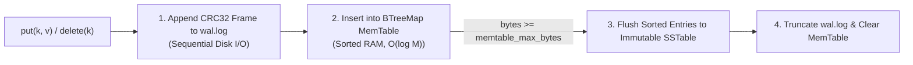

# Architecture Design: `itr-lsm` (Log-Structured Merge-Tree Storage Engine)

- **Architecture Domain**: Data & Storage Engines
- **System Layer**: Persistent Disk Key-Value Engine
- **Status**: Implemented & Tested (`cargo test -p itr-lsm`)
- **Crate**: `itr-lsm` (`crates/itr-lsm`)
- **ADR**: [`specs/adr/0005-lsm-tree-storage-engine.md`](../../specs/adr/0005-lsm-tree-storage-engine.md)

---

## 1. The Core Problem: Why In-Place Updates Bottleneck Disks

Traditional B-Tree / B+Tree engines mutate records **in place** on fixed 4KB–16KB disk pages:
- Modifying 100 random keys triggers up to **100 random disk seeks** and dirty page flushes.
- Even on NVMe SSDs, random 4KB writes suffer from internal flash page erase cycles (**Write Amplification**).

An **LSM-Tree** transforms every random mutation (`put` / `delete`) into **sequential append-only disk I/O**, saturating sequential disk bandwidth.

---

## 2. Write Path: WAL + MemTable



### Write-Ahead Log (`wal.log`)
Before a write touches RAM, it is framed sequentially with an IEEE CRC32 checksum:

```text
+---------+-------------+-------------+-----------+-----------+-------------+
| op (1B) | key_len(4B) | val_len(4B) | crc32(4B) | key bytes | value bytes |
+---------+-------------+-------------+-----------+-----------+-------------+
```

- **Torn-Tail Recovery**: On sudden crash, an incomplete write at the end of `wal.log` fails length or CRC32 checks. `WriteAheadLog::open_and_recover` stops at the last valid record offset and safely truncates (`set_len`) the corrupt tail.

### Deletions via Tombstones
Because on-disk SSTables are **strictly immutable**, you cannot erase an old key inside `sst_000001.db`. Instead, `delete(k)` appends a **Tombstone** (`op = 0x02`) marker to the WAL and MemTable. When flushed, the tombstone shadows older values during lookups.

---

## 3. On-Disk SSTable v2 Binary Format, Sparse Indexing & Bloom Filters

Loading entire multi-gigabyte SSTables into RAM defeats the purpose of a disk engine. Instead, `itr-lsm` stores only a **Sparse Index** (sampling every $S$-th key, e.g. `stride = 16`), an embedded **Bloom Filter**, and a 28-byte **Footer** (maintaining read compatibility with legacy 16-byte v1 `0x4954524C` footers):

```text
+----------------------------------------------------------------------+
| Data Section                                                         |
|  [op: u8][k_len: u32][v_len: u32][key][val] ... (sorted by key)      |
+----------------------------------------------------------------------+
| Sparse Index Section (Offset = index_offset)                         |
|  Every S-th key -> [k_len: u32][key][byte_offset: u64]               |
+----------------------------------------------------------------------+
| Bloom Filter Section (Offset = bloom_offset)                         |
|  [num_bits: u32][num_hashes: u32][bitmap bytes...]                   |
+----------------------------------------------------------------------+
| Footer v2 (Fixed 28 bytes at EOF)                                    |
|  [index_offset: u64][index_count: u32][bloom_offset: u64]            |
|  [bloom_len: u32][magic: u32 = 0x4954524D]                           |
+----------------------------------------------------------------------+
```

### Read Path Complexity
To look up `key`:
1. **MemTable ($O(\log M)$)**: Return immediately if present (`Put` or `Tombstone`).
2. **SSTables (Newest $\to$ Oldest)**:
   - **Fence Check ($O(1)$)**: Skip file immediately if `key < min_key || key > max_key`.
   - **Bloom Filter Probe ($O(k)$ RAM)**: Compute $k$ double-hashed bit probes ($g_i = (h_1 + i \cdot h_2) \bmod m$). If any bit is `0`, the key is guaranteed absent—skip disk I/O completely!
   - **Sparse Index Binary Search ($O(\log(N/S))$)**: Find the rightmost index entry with `index_key <= key`.
   - **Bounded Disk Seek**: `seek()` directly to `start_offset` and read sequentially at most $S$ records until `stop_offset` or `record_key > key`.
   - **Tombstone Short-Circuit**: If a `Tombstone` is encountered, return `None` immediately—never search older SSTables!

---

## 4. Compaction: Reclaiming Space & Bounding Read Amplification

Over time, multiple flushes accumulate obsolete overwrites and tombstones across `sst_000001.db`, `sst_000002.db`, ..., `sst_00000N.db`.

`LsmEngine::compact()`:
1. Reads all SSTables from **newest to oldest**, retaining only the newest entry per key.
2. Drops all **Tombstones** (safe because every older SSTable is included in the full merge).
3. Writes the clean sorted result atomically via `.db.tmp` $\to$ `sync_all()` $\to$ `fs::rename()`.
4. Unlinks superseded SSTable files, reclaiming disk space and reducing read amplification back to $1$ SSTable.
