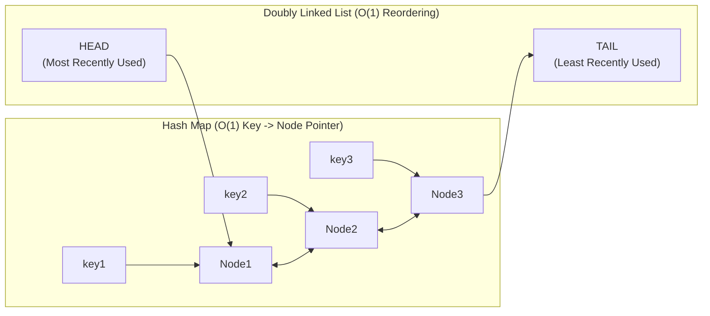

# Architecture Design: In-Memory LRU Cache Engine with TTL

- **Architecture Domain**: Data & Storage
- **System Layer**: Low-Latency In-Memory Caching
- **Status**: Implemented & Tested
- **Package**: `@intheruntime/cache` & `@intheruntime/service-cache-engine`

---

## 1. System Overview & Problem Statement

Database queries and downstream microservice HTTP calls are expensive ($10\text{ms} - 250\text{ms}$). Caching data in RAM delivers sub-microsecond responses ($< 1\,\mu\text{s}$), multiplying system throughput by orders of magnitude.

However, RAM is strictly bounded. A naive in-memory dictionary grows unboundedly, eventually causing **Out-Of-Memory (OOM) fatal crashes**.

This architecture solves the memory bound problem by combining:
1. **$O(1)$ Constant-Time Lookups**: Instant key retrieval.
2. **$O(1)$ Least Recently Used (LRU) Eviction**: Automatically drops the oldest, least valuable data when memory capacity is reached.
3. **Time-To-Live (TTL) Expiration**: Invalidates stale data with zero CPU background thrashing.

---

## 2. Core Architecture: The Doubly Linked List + Hash Map

To achieve $O(1)$ for both lookup AND eviction, we marry two distinct data structures:



### Pointer Mechanics

| Operation | Action | Time Complexity |
| :--- | :--- | :--- |
| **`get(key)`** | 1. Find node via Hash Map.<br/>2. Detach node from current linked list position.<br/>3. Re-attach node at the `HEAD` (marked MRU). | **$O(1)$** |
| **`set(key, val)`** | 1. If key exists, update value and move to `HEAD`.<br/>2. If key is new, insert at `HEAD` and map key.<br/>3. If $\text{size} > \text{capacity}$, detach `TAIL` and delete its key from Hash Map. | **$O(1)$** |
| **`delete(key)`** | 1. Find node via Hash Map.<br/>2. Detach node from linked list and delete from map. | **$O(1)$** |

---

## 3. Expiration Strategies: Lazy vs Active

### Strategy 1: Lazy Expiration (Passive)
Whenever `get(key)` is called:
```typescript
if (node.expiresAtMs !== null && Date.now() > node.expiresAtMs) {
  this.removeNode(node);
  this.lookup.delete(key);
  return undefined; // Cache miss
}
```
*Advantage*: Zero CPU cycles wasted checking keys that are never queried.

### Strategy 2: Active Sweeper (Periodic Purge)
If an item with a TTL is never queried again, lazy expiration would leave it sitting in RAM until pushed out by LRU.
The engine provides `purgeExpired()` which can be invoked on a background timer (e.g. every 60 seconds) to scavenge orphaned keys.

---

## 4. Telemetry & The Hit Ratio Formula

A cache's efficiency is quantified by its **Hit Ratio** ($H$):

$$H = \frac{\text{Hits}}{\text{Hits} + \text{Misses}}$$

- A hit ratio of $0.90$ ($90\%$) means $9$ out of $10$ requests are served directly from RAM without touching the database.
- The engine calculates and exposes real-time statistics via `GET /v1/cache/stats`:
  - `hits`, `misses`, `evictions`, `expirations`, `size`, `capacity`, and `hitRatio`.

---

## 5. Performance Comparison

| Metric | Direct Database Query | LRU In-Memory Cache | Speedup Factor |
| :--- | :--- | :--- | :--- |
| **Latency** | $15.0\,\text{ms} - 50.0\,\text{ms}$ | $0.002\,\text{ms}$ ($2\,\mu\text{s}$) | $\approx \mathbf{7,500\times}$ faster |
| **Database Load** | 10,000 queries/sec | 1,000 queries/sec (at 90% hit ratio) | $\mathbf{90\%}$ load reduction |
| **Failure Mode** | Database connection starvation | Graceful degradation to downstream | Zero cascading failures |
