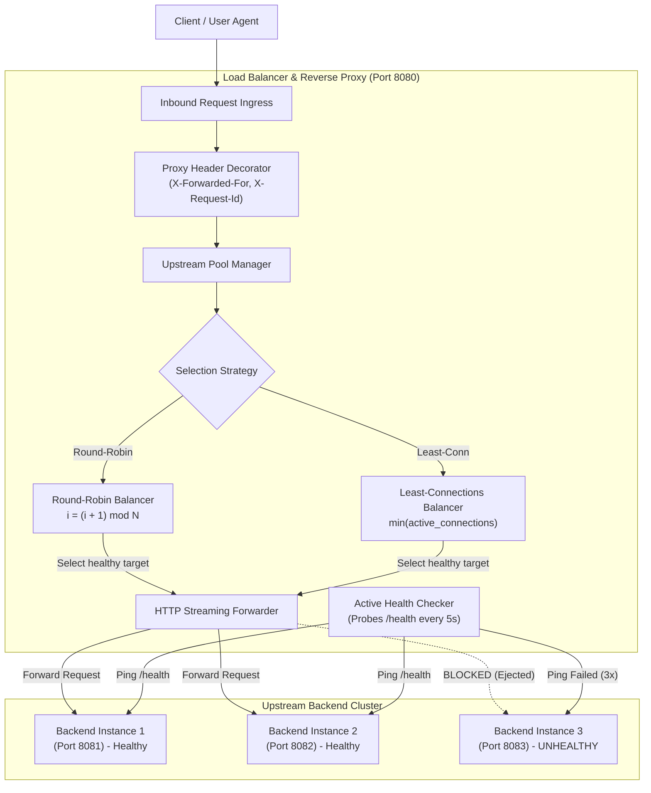
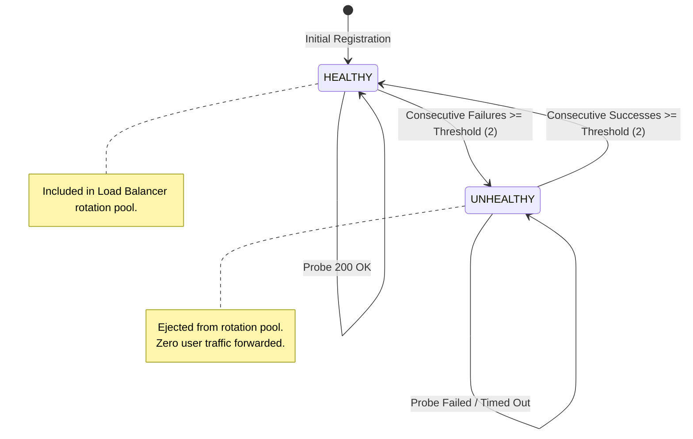

# Architecture Design: HTTP Reverse Proxy & Load Balancer

- **Architecture Domain**: Core Infrastructure
- **System Layer**: Traffic Routing & Edge Ingress
- **Status**: Implemented & Tested
- **Package**: `@intheruntime/service-load-balancer`

---

## 1. System Overview & Problem Statement

In production architectures, backend services run across multiple replica instances (containers or virtual machines). Direct exposure of individual servers introduces serious vulnerabilities and bottlenecks:
1. Clients must know internal server IP addresses.
2. If an instance crashes, clients hitting its IP suffer connection failures.
3. Traffic becomes unevenly distributed, overloading one server while others sit idle.

The **Reverse Proxy & Load Balancer** solves this by acting as the unified "Front Door":
- Exposes a single public address.
- Distributes inbound requests evenly across healthy replicas.
- Continuously probes backend instances, automatically ejecting dead nodes without dropping user traffic.

---

## 2. Core Architecture: The Load Balancing Pipeline

---

## 3. Load Balancing Algorithms

### A. Round-Robin Algorithm ($O(1)$)
Maintains an atomic circular pointer modulo the count of healthy targets ($N$):

$$i_{\text{next}} = (i_{\text{current}} + 1) \pmod N$$

- **Pros**: Zero overhead, perfectly uniform distribution for homogeneous requests.
- **Cons**: Does not account for varying request execution durations (e.g. a heavy report vs a fast health check).

### B. Least-Connections Algorithm ($O(N)$)
Tracks in-flight requests per backend target:

$$\text{Target} = \arg\min_{t \in \text{HealthyTargets}} (\text{active\_connections}_t)$$

- When a request begins forwarding: increment `active_connections++`.
- When upstream response completes: decrement `active_connections--`.
- **Pros**: Automatically routes traffic away from slow or bogged-down servers to faster, idle nodes.

---

## 4. Active Health Check State Machine

Instead of waiting for a user request to fail ("passive health checking"), the Load Balancer actively probes backends in the background:

- **Failure Threshold**: 2 consecutive failed health checks transition a node to `UNHEALTHY`.
- **Success Threshold**: 2 consecutive successful checks restore the node to `HEALTHY`.
- **Zero-Downtime Failover**: If a server crashes mid-operation, the balancer re-routes subsequent traffic instantly to remaining replicas.

---

## 5. Standard Proxy Headers

The balancer decorates all outbound requests with standard forwarding headers:

| Header | Purpose | Example |
| :--- | :--- | :--- |
| `X-Forwarded-For` | Preserves original client IP through the proxy chain | `203.0.113.195` |
| `X-Forwarded-Proto` | Informs backend of original protocol | `http` or `https` |
| `X-Forwarded-Host` | Informs backend of client's requested hostname | `api.intheruntime.com` |
| `X-Request-Id` | Unique UUID for distributed tracing across services | `req_98b7a12f` |

---

## 6. Failure Modes & Mitigations

| Failure Mode | Impact | Mitigation Strategy |
| :--- | :--- | :--- |
| **All Backends Unhealthy** | Proxy cannot fulfill any request. | Returns **`502 Bad Gateway`** with structured error JSON informing caller that no upstream instances are alive. |
| **Backend Connection Timeout** | Forwarded request hangs. | Enforces strict upstream request timeout (e.g. 5,000ms), aborting connection and failing fast. |
| **Flapping Backend** | Server rapidly alternates between up and down. | Dual-threshold state machine requires 2 consecutive successes before re-admitting node to rotation. |
