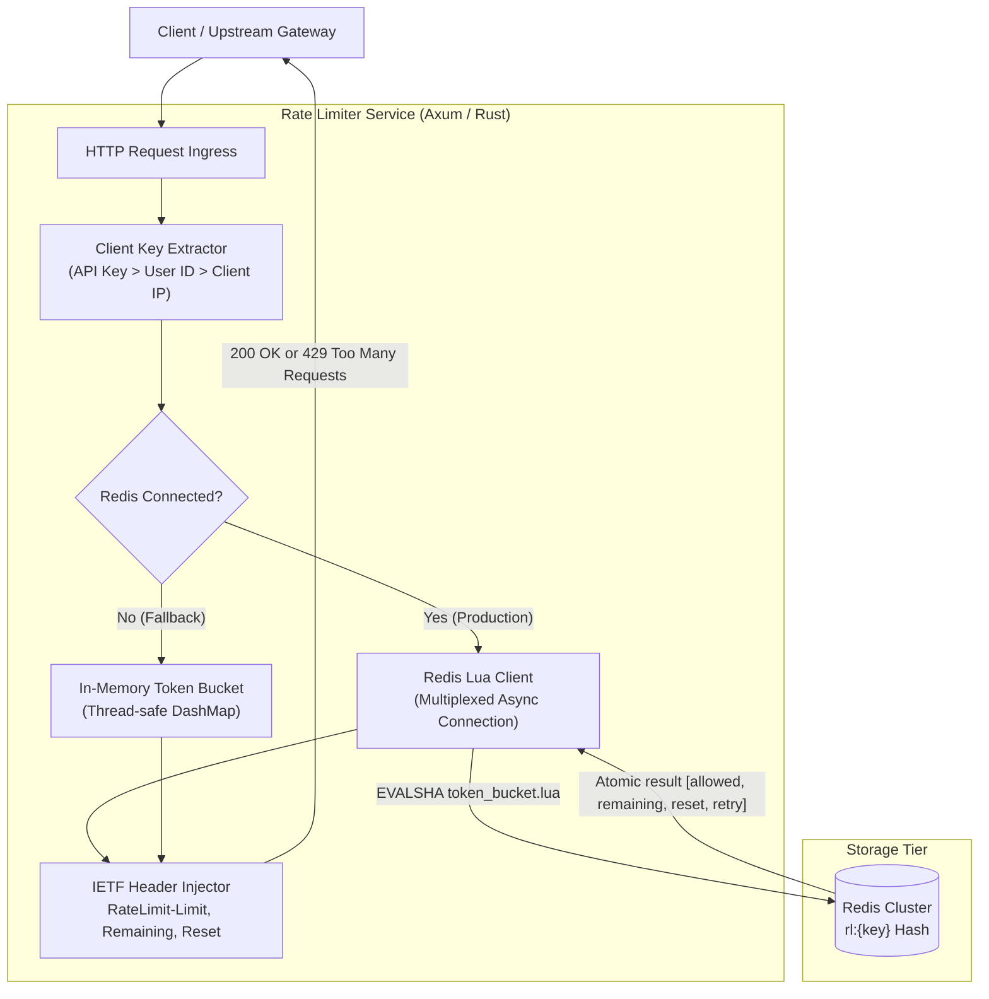

# Architecture Design: Distributed Token Bucket Rate Limiter

- **Architecture Domain**: Core Infrastructure
- **System Layer**: Traffic Shaping & Edge Protection
- **Status**: Implemented & Tested
- **Languages**: Rust (Axum, Tokio) + Redis (Lua)

---

## 1. System Overview & Problem Statement

Modern APIs face unpredictable traffic spikes, runaway client loops, and distributed denial-of-service (DDoS) threats. Without rate limiting, an overload in inbound requests cascades into database connection exhaustion, elevated p99 latencies, and service crashes.

This system provides **sub-millisecond rate limiting** that can run either:
1. **Clustered / Distributed Mode**: Backed by atomic Redis Lua scripts so multiple server replicas share token quotas without distributed lock contention.
2. **Local In-Memory Mode**: Using thread-safe concurrent buckets (`DashMap`) with zero external dependencies.

---

## 2. Core Architecture & Data Flow



---

## 3. Mathematical Model: Continuous Token Bucket

Traditional systems use naive "fixed windows" (e.g. 60 requests per minute). Fixed windows suffer from the **Boundary Burst Problem**: a client can send 60 requests at second 59 and 60 requests at second 01, inflicting 120 requests in 2 seconds.

The continuous Token Bucket completely eliminates this flaw:

### Refill Formula (Lazy Evaluation)
No background timers are used. Refill is calculated purely upon request arrival:

$$\Delta t = \max(0, \ t_{\text{now}} - t_{\text{last}})$$

$$\text{refilled} = \Delta t \times R_{\text{refill}}$$

$$\text{tokens} = \min(C_{\text{capacity}}, \ \text{tokens}_{\text{prev}} + \text{refilled})$$

Where:
- $C_{\text{capacity}}$: Maximum token burst capacity (e.g., 10 tokens).
- $R_{\text{refill}}$: Refill rate in tokens per second (e.g., 2 tokens/sec).
- $t_{\text{now}}$: Current timestamp in seconds (with sub-millisecond precision).

### Decision & State Mutation
If $\text{tokens} \ge \text{cost}$:
$$\text{allowed} = \text{true}$$
$$\text{tokens}_{\text{new}} = \text{tokens} - \text{cost}$$
$$\text{reset\_after} = \left\lceil \frac{C_{\text{capacity}} - \text{tokens}_{\text{new}}}{R_{\text{refill}}} \right\rceil$$

If $\text{tokens} < \text{cost}$:
$$\text{allowed} = \text{false}$$
$$\text{retry\_after} = \left\lceil \frac{\text{cost} - \text{tokens}}{R_{\text{refill}}} \right\rceil$$

---

## 4. Race Condition Analysis & Atomic Lua Execution

### Why Naive Redis Read-Then-Write Fails
A classic Time-of-Check to Time-of-Use (TOCTOU) race condition:
```text
Time    Server Instance 1 (Req 1)             Server Instance 2 (Req 2)
───────────────────────────────────────────────────────────────────────────
t0      redis.get("rl:user_1") -> 1 token
t1                                            redis.get("rl:user_1") -> 1 token
t2      1 >= 1 -> Allow! Decrement to 0
t3                                            1 >= 1 -> Allow! Decrement to 0
t4      redis.set("rl:user_1", 0)
t5                                            redis.set("rl:user_1", 0)
```
*Result*: Both servers granted the request. A single token was spent twice.

### The Lua Solution
Redis executes Lua scripts atomically in a single event-loop cycle. When `token_bucket.lua` runs:
1. State read (`HMGET`).
2. Elapsed time computation.
3. Token deduction and header calculations.
4. State write (`HMSET` & `EXPIRE`).
All happen sequentially with **zero possibility of intervening reads or writes from other nodes**.

---

## 5. Standard IETF Response Headers

All responses strictly follow the modern IETF Draft RateLimit specification:

```http
HTTP/1.1 200 OK
RateLimit-Limit: 10
RateLimit-Remaining: 7
RateLimit-Reset: 2
```

When quota is exhausted:

```http
HTTP/1.1 429 Too Many Requests
Retry-After: 1
RateLimit-Limit: 10
RateLimit-Remaining: 0
RateLimit-Reset: 5
Content-Type: application/json

{
  "error": "too_many_requests",
  "message": "Rate limit quota exceeded. Please retry after 1 seconds.",
  "retry_after_secs": 1
}
```

---

## 6. Failure Modes & Mitigations

| Failure Mode | Impact | Mitigation Strategy |
| :--- | :--- | :--- |
| **Redis Unreachable** | Gateway cannot query centralized state. | **Automatic Failover**: Service transparently falls back to local `InMemoryRateLimiter`. Requests continue being throttled locally rather than dropping traffic. |
| **Clock Skew between Nodes** | Timestamps might jump backward. | Lua script uses `math.max(0, now - last_updated)` ensuring monotonic progress. |
| **Redis Memory Growth** | Storing millions of inactive user keys. | Dynamic `EXPIRE` set to $2 \times (\text{capacity} / \text{refill\_rate})$. Inactive buckets are automatically evicted by Redis TTL. |
