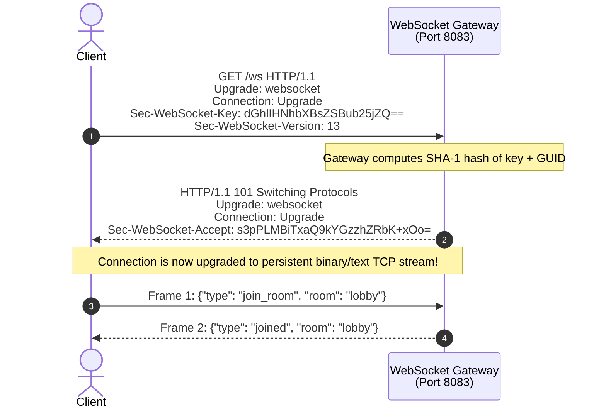
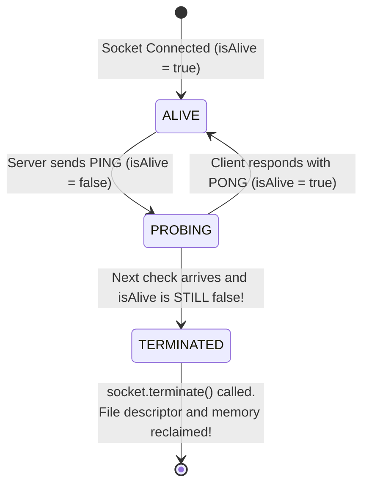
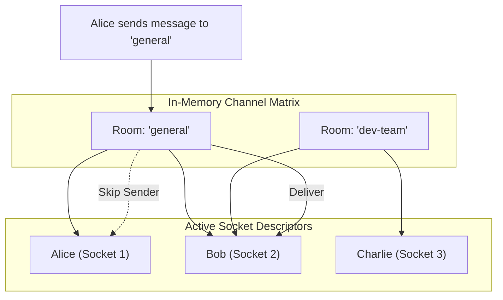
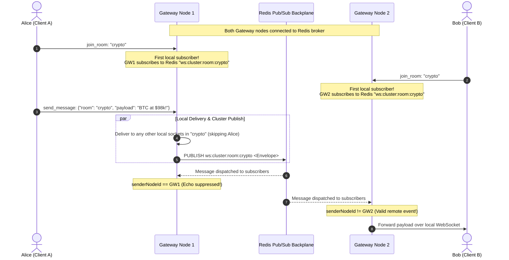

# Architecture Design: WebSocket Gateway & Clustered Pub/Sub Backplane

- **Architecture Domain**: Real-Time & Messaging
- **System Layer**: Persistent Bi-Directional Transport & Clustered Fan-Out
- **Status**: Implemented & Tested
- **Package**: `@intheruntime/service-websocket-gateway`

---

## 1. System Overview & The Core Problem

HTTP is inherently request-driven: a client opens a connection, asks for data, and closes the connection. In applications requiring instant updates (chat, financial tick-by-tick tickers, live ride tracking, collaboration), HTTP polling produces catastrophic overhead:
- Periodic polling requests send 1KB+ HTTP headers repeatedly for empty payloads.
- High connection establishment latency ($3\text{x}$ TCP + TLS handshakes).
- Rapid battery and mobile bandwidth drain.

The **WebSocket Gateway** provides a persistent, full-duplex TCP channel over port 80/443:
- Messages travel in both directions with only a **2-byte framing overhead**.
- Latency drops from seconds to **sub-5-milliseconds**.
- Server can push events spontaneously to 100,000+ connected clients without waiting to be asked.

---

## 2. The Connection Handshake (101 Switching Protocols)

WebSockets piggyback on HTTP port 80/443 so they pass through firewalls and corporate proxies transparently:

---

## 3. The "Zombie Connection" Problem & Heartbeat Protocol

### The TCP Half-Open Nightmare
In mobile networks, a client device often drives into a tunnel, switches from Wi-Fi to 5G, or runs out of battery. The client drops off the face of the earth **without sending a TCP FIN or RST packet**.
- The server believes the client is still connected.
- Default OS TCP keep-alive can take **up to 2 hours** to notice the connection is dead!
- Result: Servers accumulate tens of thousands of "ghost" sockets, leaking file descriptors and memory.

### The Heartbeat State Machine

1. Every 15 seconds, the Gateway sweeps all connections and sends a `PING`.
2. It sets `isAlive = false` on each socket.
3. If the client is alive, its network stack responds with `PONG`, resetting `isAlive = true`.
4. If the next 15-second sweep arrives and `isAlive` is still `false`, the client has died silently. The Gateway calls `socket.terminate()`, instantly freeing memory.

---

## 4. Room & Channel Architecture

Clients do not just talk to the server; they participate in specific topics (e.g. `room:general`, `game:lobby_42`).

---

## 5. Horizontal Scaling & The Multi-Node Partitioning Trap

When scaling horizontally behind a load balancer, persistent TCP sockets cannot be shared across physical machine boundaries.

If **Alice** connects to **Gateway Node 1** and **Bob** connects to **Gateway Node 2**, both in room `"trading"`:
- Alice sends a message to Gateway Node 1.
- Node 1 only checks its local connection table and sees Alice.
- **Node 2 never receives the message, and Bob hears complete silence.**

### Topology Comparison: P2P Mesh vs. Pub/Sub Backplane

| Property | Full-Mesh Peer-to-Peer | Centralized Pub/Sub Backplane (Redis) |
| :--- | :--- | :--- |
| **Connection Complexity** | $\mathcal{O}(N^2)$ connections between $N$ nodes | $\mathcal{O}(N)$ connections (each node connects to broker) |
| **Cluster Churn** | Node joining/leaving triggers $N-1$ reconnections | Nodes connect/disconnect independently from Redis |
| **Bandwidth Amplification** | Severe: every node replicates to all peers | Managed: broker filters subscriptions by channel |
| **Industry Usage** | P2P audio/video (WebRTC mesh) | Slack, Discord, Pusher, Phoenix Channels |

---

## 6. The Redis Pub/Sub Backplane Architecture

### Dynamic Topic Ref-Counting ($\mathcal{O}(\text{Active Local Rooms})$)

To prevent gateway nodes from being overwhelmed by global cluster traffic across thousands of idle rooms:
1. **Dynamic Subscribe**: A gateway node executes `redis.subscribe(room)` **only when the local subscriber count transitions from 0 to 1**.
2. **Dynamic Unsubscribe**: When the last local socket leaves a room or disconnects (local subscribers drop from 1 to 0), the gateway executes `redis.unsubscribe(room)`.
3. **Echo Suppression**: Envelopes carry `senderNodeId`. When Redis broadcasts a message back to the originating node, the node verifies `msg.senderNodeId === this.nodeId` and silently drops it to prevent duplicate local delivery.
