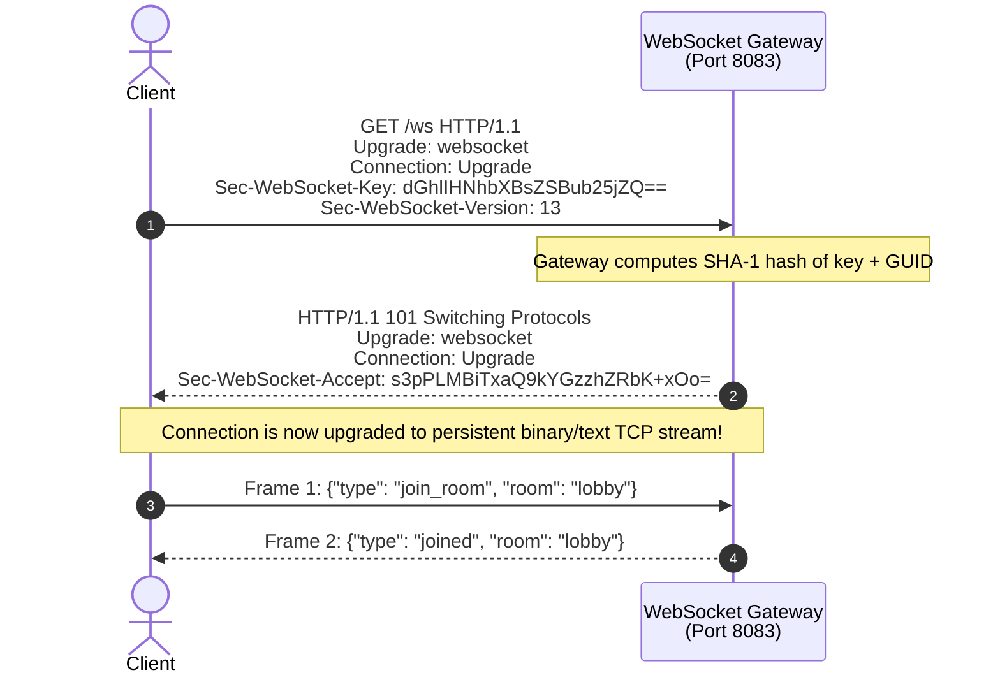
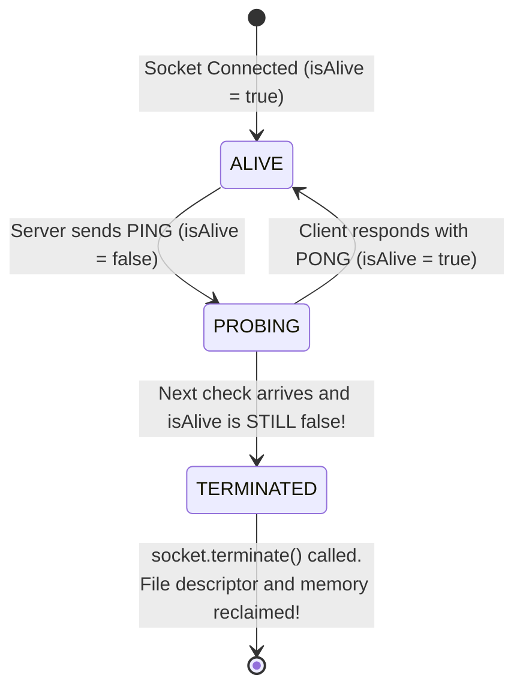
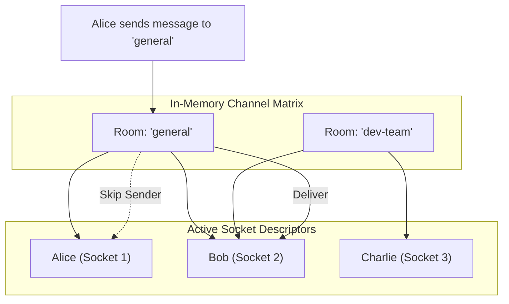

# Architecture Design: WebSocket Gateway & Connection Lifecycle

- **Architecture Domain**: Real-Time & Messaging
- **System Layer**: Persistent Bi-Directional Transport
- **Status**: Implemented & Tested
- **Package**: `@intheruntime/service-websocket-gateway`

---

## 1. System Overview & The Core Problem

HTTP is inherently request-driven: a client opens a connection, asks for data, and closes the connection. In applications requiring instant updates (chat, financial tick-by-tick tickers, live ride tracking, collaboration), HTTP polling produces catastrophic overhead:
- Periodic polling requests send 1KB+ HTTP headers repeatedly for empty payloads.
- High connection establishment latency ($3\text{x}$ TCP + TLS handshakes).
- Rapid battery and mobile bandwidth drain.

The **WebSocket Gateway** provides a single persistent, full-duplex TCP channel over port 80/443:
- Messages travel in both directions with only a **2-byte framing overhead**.
- Latency drops from seconds to **sub-5-milliseconds**.
- Server can push events spontaneously to 100,000+ connected clients without waiting to be asked.

---

## 2. The Connection Handshake (101 Switching Protocols)

WebSockets piggyback on HTTP port 80/443 so they pass through firewalls and corporate proxies transparently:

---

## 3. The "Zombie Connection" Problem & Heartbeat Protocol

### The TCP Half-Open Nightmare
In mobile networks, a client device often drives into a tunnel, switches from Wi-Fi to 5G, or runs out of battery. The client drops off the face of the earth **without sending a TCP FIN or RST packet**.
- The server believes the client is still connected.
- Default OS TCP keep-alive can take **up to 2 hours** to notice the connection is dead!
- Result: Servers accumulate tens of thousands of "ghost" sockets, leaking file descriptors and memory.

### The Heartbeat State Machine

1. Every 15 seconds, the Gateway sweeps all connections and sends a `PING`.
2. It sets `isAlive = false` on each socket.
3. If the client is alive, its network stack responds with `PONG`, resetting `isAlive = true`.
4. If the next 15-second sweep arrives and `isAlive` is still `false`, the client has died silently. The Gateway calls `socket.terminate()`, instantly freeing memory.

---

## 4. Room & Channel Architecture

Clients do not just talk to the server; they participate in specific topics (e.g. `room:general`, `game:lobby_42`).

- When a client sends a message to room `general`, the connection manager retrieves the room's set of active connection IDs in **$O(1)$** time.
- It iterates through the set and pushes the message frame directly to their socket buffers.
- When a client disconnects, it is automatically unlinked from all subscribed rooms with zero memory leaks.
