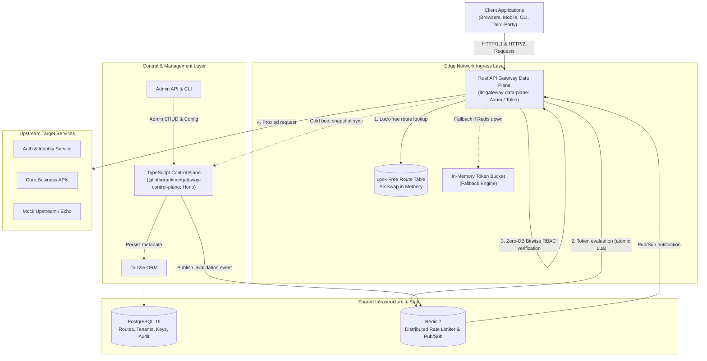

# System Architecture Topology

This document describes the overall system architecture topology for the `architectures` monorepo core infrastructure, illustrating the boundary separation between high-performance edge components and control planes.

---

## Topology Architecture

---

## Component Responsibilities

| Component | Technology | Primary Responsibility |
| :--- | :--- | :--- |
| **Data Plane** | Rust, Axum, Tokio, Tower | Sub-millisecond reverse proxying, connection pooling, zero-database hot path JWT/key authorization, and token-bucket rate limiting. |
| **Control Plane** | TypeScript, Hono, Drizzle | Administrative route CRUD, tenant lifecycle, role-to-bitmask mapping, API key generation, and schema validation. |
| **PostgreSQL** | PostgreSQL 16 | Durable relational system of record for routes, tenants, permissions, and audit logs. |
| **Redis** | Redis 7 | Atomic distributed token bucket state via preloaded Lua scripts, and Pub/Sub channel for instantaneous cache invalidation. |
| **Mock Upstream** | Docker HTTP Echo | Reliable verification target during local testing and automated E2E suites. |
