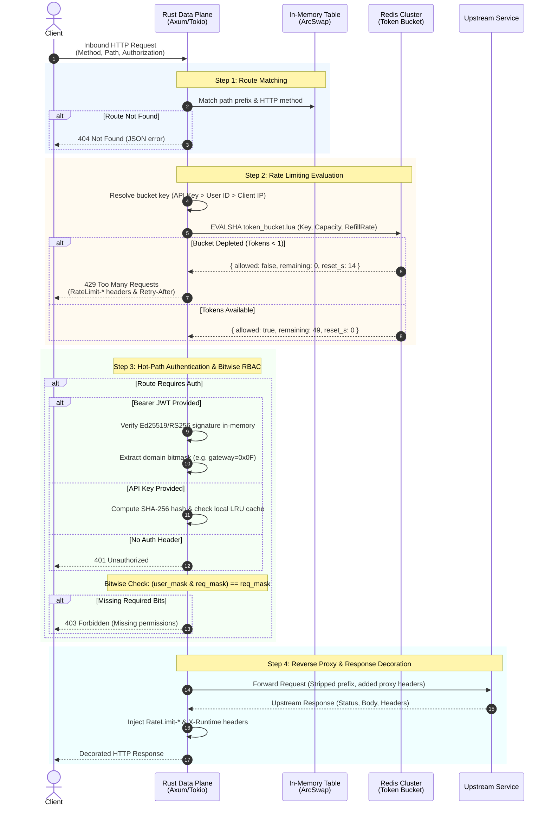

# API Gateway Hot-Path Request Flow

This document details the exact sequence of operations executed by the Rust Data Plane on the high-throughput request hot path.

---

## Sequence Flow Diagram

---

## Latency Budgets on Hot Path

| Pipeline Phase | Mechanism | Target Latency |
| :--- | :--- | :--- |
| **Route Lookup** | In-Memory `ArcSwap<RouteTable>` prefix tree | $< 5\,\mu\text{s}$ |
| **Rate Limit Check** | Redis connection pool + single atomic Lua `EVALSHA` | $0.2 - 0.6\,\text{ms}$ |
| **Auth Verification** | Local cryptographic JWT check or cached key hash | $< 25\,\mu\text{s}$ |
| **Bitwise RBAC Check** | Single CPU bitwise AND operation (`AND` + `CMP`) | $< 10\,\text{ns}$ |
| **Reverse Proxy I/O** | Hyper connection-pooled async client | Network bound ($< 1\,\text{ms}$ local) |
